
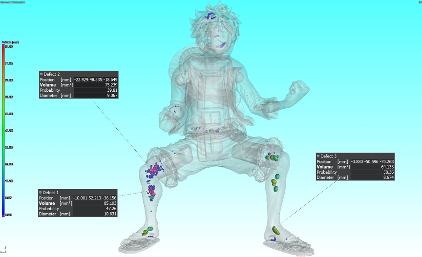

工业CT，即工业计算机断层成像技术，被誉为”最佳无损检测手段“。基于CT的缺陷分析如今已被广泛应用,如铸件、塑料零件和BGAs。快速、准确、直观的查找到产品的内部缺陷（缺陷类型、位置、尺寸等），如裂纹、气孔、疏松、夹杂等缺陷，并进行分析，找到出现缺陷的根本原因，从而提高产品性能，延长产品使用寿命。

<h2 id="基础知识">基础知识</h2>
<a target="_blank" rel="noopener" href="https://zhuanlan.zhihu.com/p/400069707">https://zhuanlan.zhihu.com/p/400069707</a>

<a target="_blank" rel="noopener" href="https://zhuanlan.zhihu.com/p/409783356">https://zhuanlan.zhihu.com/p/409783356</a>

<h2 id="竞争对手">竞争对手</h2>
<a target="_blank" rel="noopener" href="http://www.xrayct.net/">http://www.xrayct.net/</a>

<a target="_blank" rel="noopener" href="https://www.zeiss.com.cn/gongyeceliang/chanpin/xitong/ctduancengsaomiao.html/#products">https://www.zeiss.com.cn/gongyeceliang/chanpin/xitong/ctduancengsaomiao.html\#products</a>

<a target="_blank" rel="noopener" href="https://www.sypi.com/">https://www.sypi.com/</a>

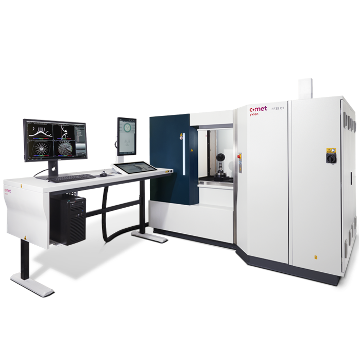

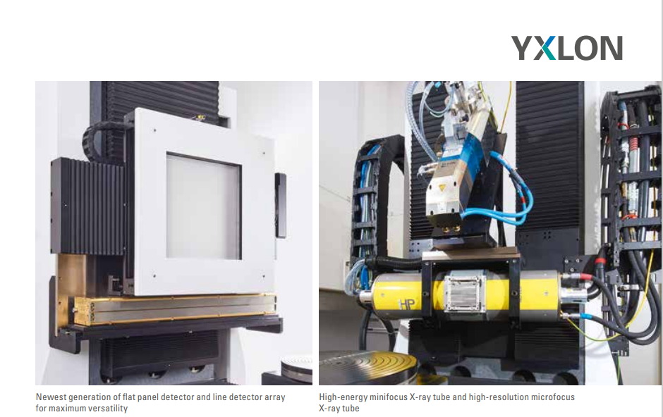

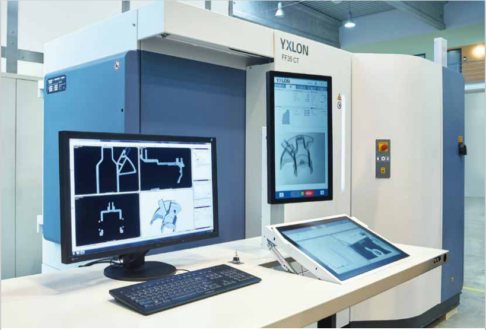

<h2 id="CT原理和参数">CT原理和参数</h2>
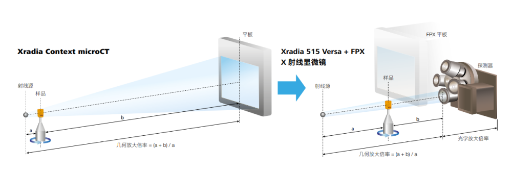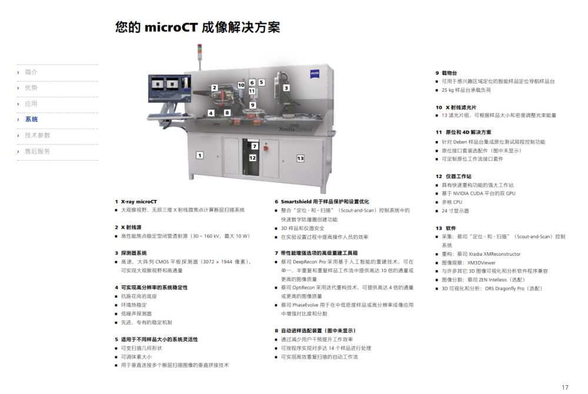

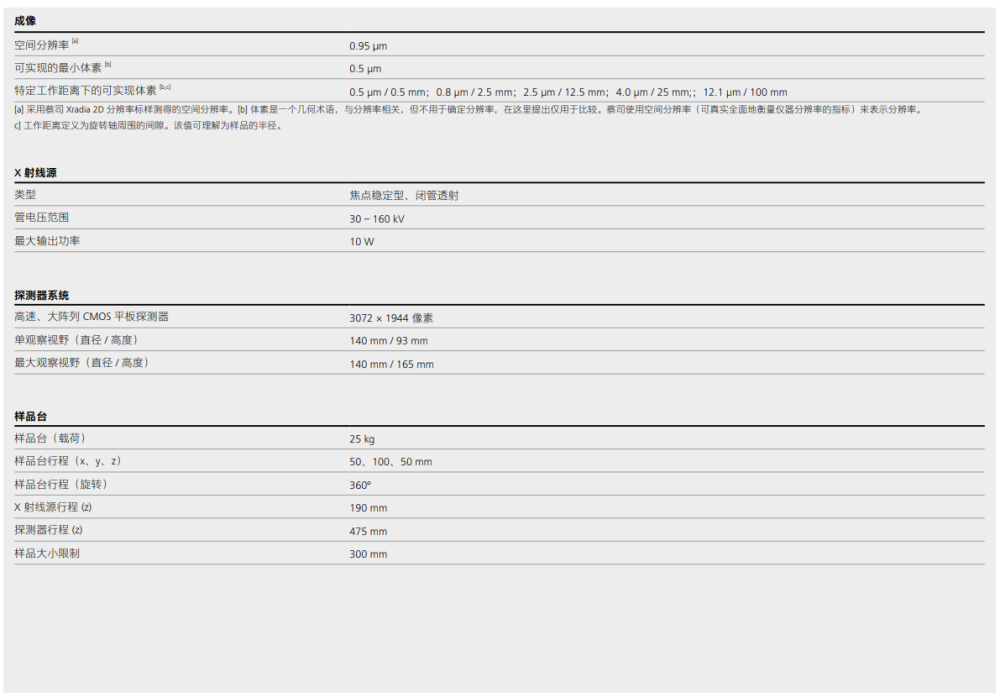

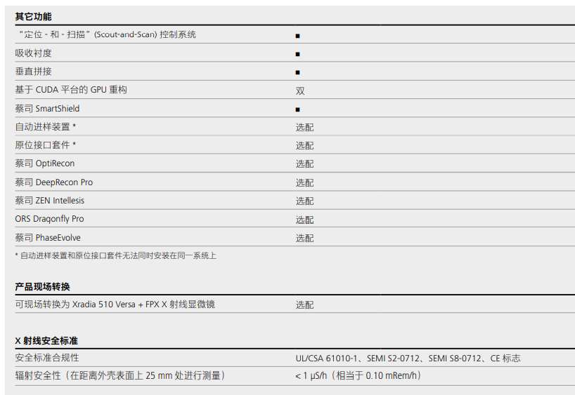

<h2 id="蔡司控制软件">蔡司控制软件</h2>
<a target="_blank" rel="noopener" href="https://www.zeiss.com.cn/microscopy/products/x-ray-microscopy/analysis-software.html">https://www.zeiss.com.cn/microscopy/products/x-ray-microscopy/analysis-software.html</a>

<a target="_blank" rel="noopener" href="https://www.zeiss.com/content/dam/z/rms/countries/united-states/campaigns/scout-and-scan/en_promo-video_smartshield_final_subtitles-v2.mp4">https://www.zeiss.com/content/dam/z/rms/countries/united-states/campaigns/scout-and-scan/en_promo-video_smartshield_final_subtitles-v2.mp4</a>

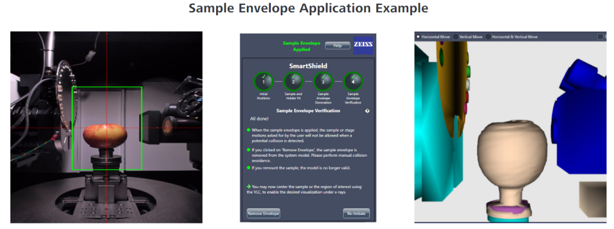

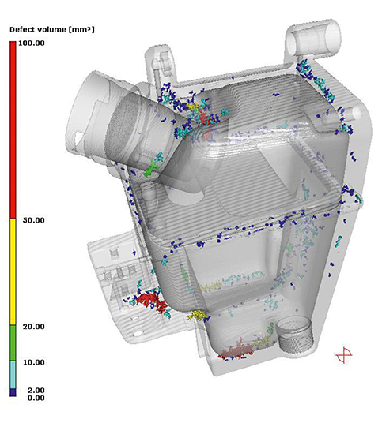

<a target="_blank" rel="noopener" href="https://yxlon.comet.tech/zh/technologies-zh/industrial-ct">https://yxlon.comet.tech/zh/technologies-zh/industrial-ct</a>

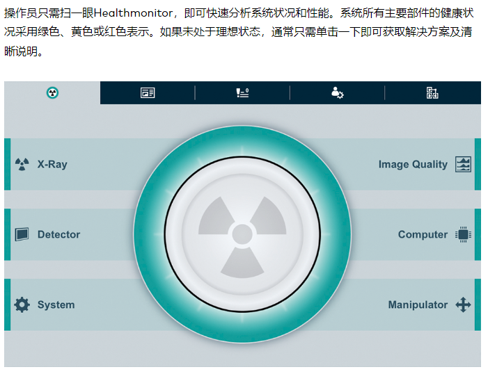

