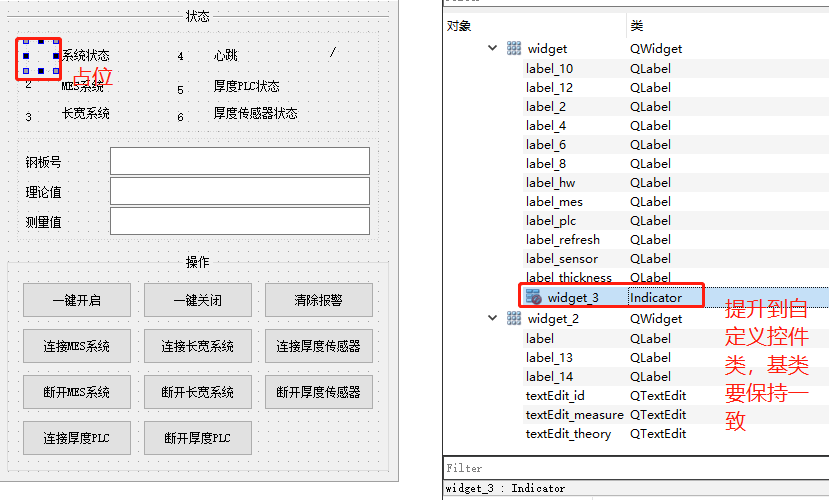
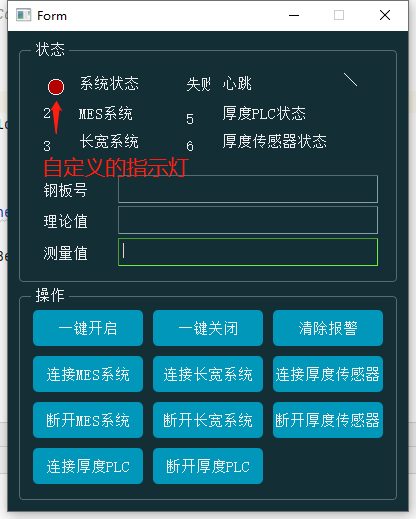

<h2 id="核心思想">核心思想</h2>
第一步：在 Qt Designer 中,假如您已经定义了一个从 QWidget 派生的小部件 Indicator，那么您可以在此处定义它，然后只需在您的 ui 中插入一个 QWidget 作为<strong>占位符</strong>并将其提升到 Indicator。

第二步：将 UI 文件转换为 UI_StatusBox.py <code>pyuic5.exe -o .\UI_StatusBox.py .\UI_StatusBox.ui</code>

第三步：在主 python 文件中正常加载 Indicator 类，并将其赋值给类变量，这样

<h2 id="实践">实践</h2>
第一步：绘制UI文件，占位

第二步：将 UI 文件转换为 UI_StatusBox.

通过指令<code>pyuic5.exe -o .\UI_StatusBox.py .\UI_StatusBox.ui</code> 将上一步的UI文件转换为python代码，形如

<figure class="highlight css"><table><tr><td class="gutter"><pre>1 2 3 4 5 6 7 8 9 10 11 12 13 14 15 16 17 18 19 20 21 22 23 </pre></td><td class="code"><pre>from PyQt5 import QtCore, QtGui, QtWidgets   class Ui_Form(object):     def setupUi(self, Form):         Form.setObjectName(&quot;Form&quot;)         Form.resize(400, 480)         Form.setMinimumSize(QtCore.QSize(400, 480))         Form.setMaximumSize(QtCore.QSize(400, 480))         Form.setStyleSheet(&quot;&quot;)         self.verticalLayout_2 = QtWidgets.QVBoxLayout(Form)         self.verticalLayout_2.setObjectName(&quot;verticalLayout_2&quot;)         self.groupBox_2 = QtWidgets.QGroupBox(Form)         self.groupBox_2.setMinimumSize(QtCore.QSize(300, 240))         self.groupBox_2.setMaximumSize(QtCore.QSize(400, 240))         self.groupBox_2.setAlignment(QtCore.Qt.AlignCenter)         self.groupBox_2.setFlat(True)          self.widget_3 = Indicator(self.widget)         self.widget_3.setMinimumSize(QtCore.QSize(30, 30))         self.widget_3.setMaximumSize(QtCore.QSize(30, 30))         self.widget_3.setObjectName(&quot;widget_3&quot;)  </pre></td></tr></table></figure>

可以看到 Indicator 类已经引入，后面就可以正常在python中进行控件的绘制和加载了。

第三步：在主 python 文件中正常加载 Indicator.py 和主 python文件。

<code>Indicator.py</code>

<figure class="highlight css"><table><tr><td class="gutter"><pre>1 2 3 4 5 6 7 8 9 10 11 12 13 14 15 16 17 18 19 20 21 22 23 24 25 26 27 28 </pre></td><td class="code"><pre>from PyQt5.QtGui import QPainter, QColor from PyQt5.QtWidgets import QWidget   class Indicator(QWidget):     def __init__(self,parent=None):         super().__init__(parent)         self.color = QColor(255, 0, 0)         # self.initUI()      def initUI(self):         self.setGeometry(100, 100, 100, 100)         self.setWindowTitle(&#x27;Status Indicator&#x27;)      def paintEvent(self, event):         qp = QPainter()         qp.begin(self)         self.drawIndicator(qp)         qp.end()      def drawIndicator(self, qp):         qp.setBrush(self.color)         qp.drawEllipse(10, 10, 15,15) #x,y,w,h      def setColor(self, color):         self.color = color         self.update()  </pre></td></tr></table></figure>

<code>效果</code> 

<h2 id="参考链接">参考链接</h2>
[1] <a target="_blank" rel="noopener" href="https://stackoverflow.com/questions/19622014/how-do-i-use-promote-to-in-qt-designer-in-pyqt4">how-do-i-use-promote-to-in-qt-designer-in-pyqt4</a> [2] <a target="_blank" rel="noopener" href="https://blog.csdn.net/yg2496194392/article/details/122283420">PyQt5 在 qtdesigner 中使用自定义的控件</a> [3] <a target="_blank" rel="noopener" href="https://doc.qt.io/archives/qq/qq26-pyqtdesigner.html">Designing Custom Controls with PyQt</a>

