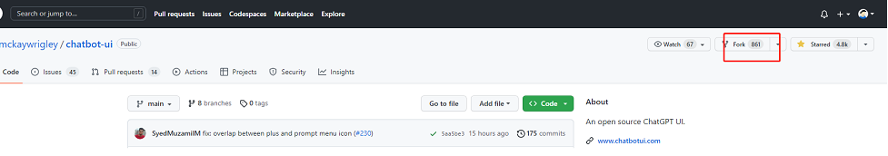
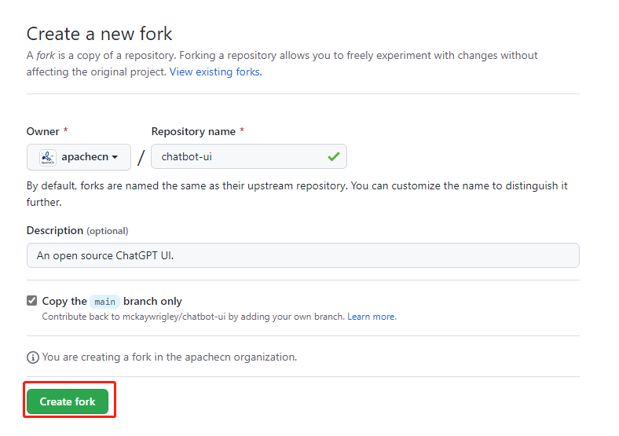
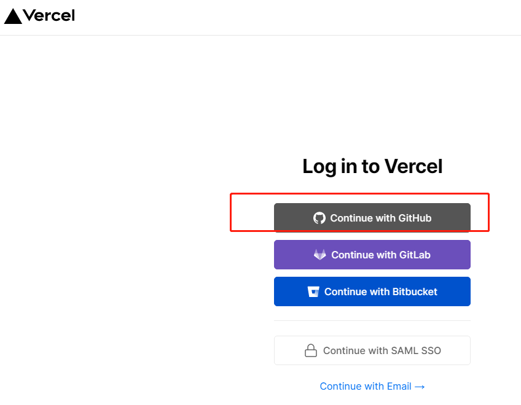
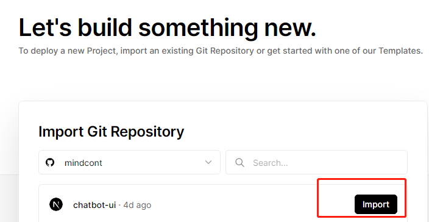
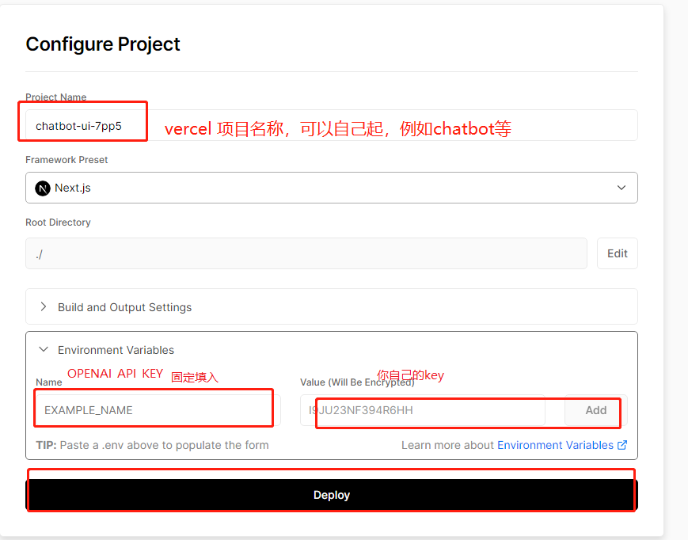
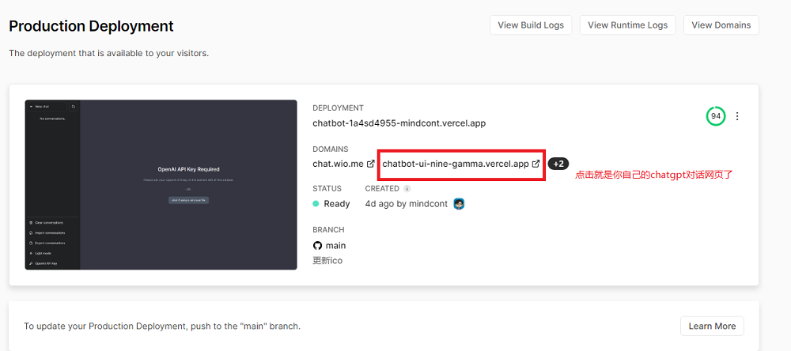

Chatgpt 如火如荼，如何搭建自己的 chatgpt 服务呢？这里我们采用的技术路线 “OpenAI key” + “Chatbot UI” + “Vercel”实现。

<!--more-->

和将一头大象放入冰箱的步骤一样，简单为三步： 1、申请 OpenAI 的 key; 2、将 Chatbot UI 项目 clone 到自己的 github 账号下； 3、创建 Vecel 项目 简单配置 然后 Vecel 会自动构建部署。 就可以使用了。

<h2 id="申请-OpenAI-key">申请 OpenAI key</h2>
参照 <a target="_blank" rel="noopener" href="https://cloud.tencent.com/developer/article/2190154">一文教你快速注册 OpenAi</a>

这里不在重复，经过这一步你需要拿到形如“sk-hyaUTHpxxxxxxxxxxxxxxx” 一个 key,即可进入下一步。

<h2 id="clone-到自己的-github-账号下">clone 到自己的 github 账号下</h2>
1、打开项目地址 <code>https://github.com/mckaywrigley/chatbot-ui</code>， 点击 fork 

2、点击 create fork. 

<h2 id="Vecel-项目和部署">Vecel 项目和部署</h2>
1、注册 Vercel 账号，推荐使用 GitHub 账号登录。 

2、点击创建 Vercel 项目，import 刚才 clone 的 github 账号下的项目。 

3、配置项目 

ok !!! 

