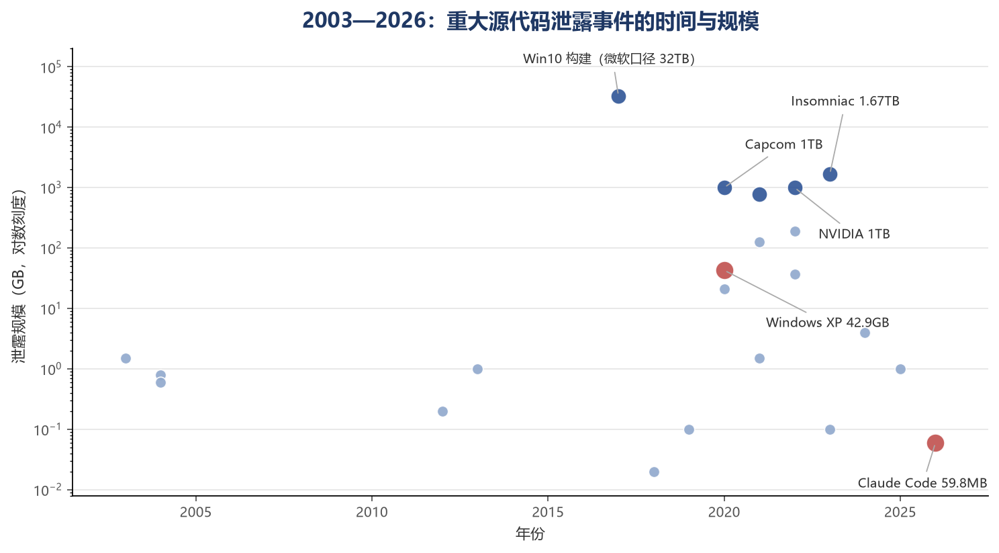
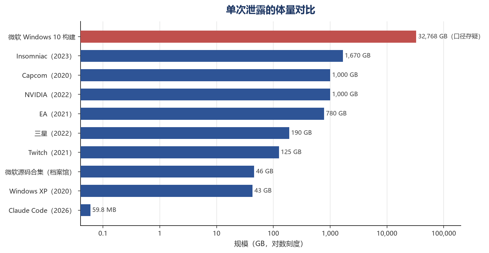
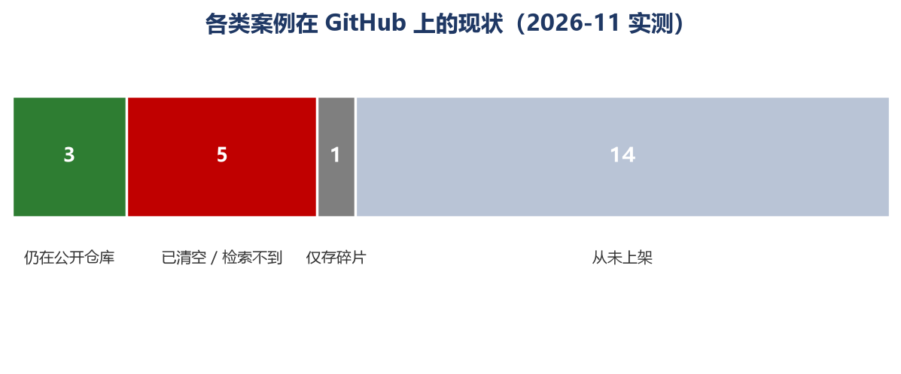
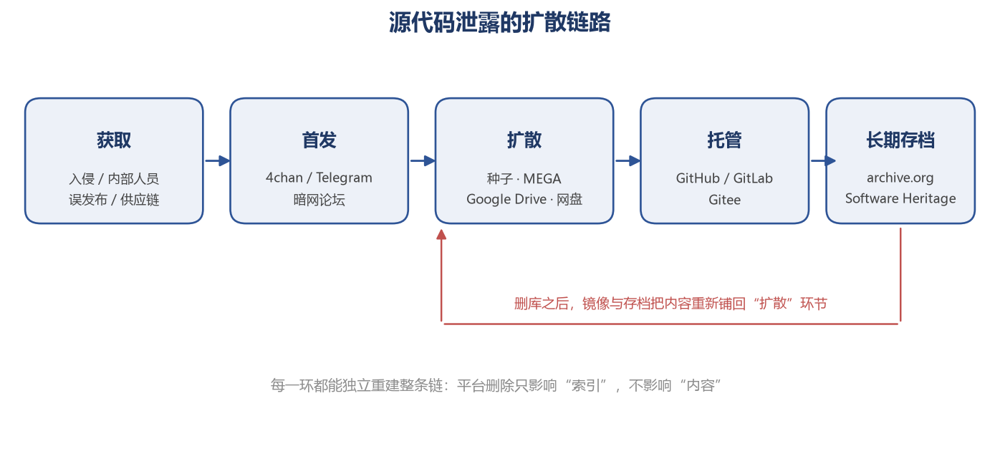

> **2003—2026 ｜ 从 Windows XP 到 Claude Code**  
> 资料整理｜2026 年 11 月

本文按“规模大、影响广、有代表性”三个标准，梳理 2003 年以来的三十余起重大源代码泄露事件。二十多年间，这类事件大致走过四波：2003—2004 年的早期事件，2012—2014 年转向黑产，2017—2021 年操作系统与游戏业集中爆发，2022 年至今勒索软件、Lapsus$ 与配置失误交织。其中微软 Windows XP，属于第三波，也是传播最广的一起。

<!--more-->

---

## 目录

- [一、微软 Windows XP 泄露（2020）](#一、微软-Windows-XP-泄露（2020）)
- [二、时间线：代表性事件](#二、时间线：代表性事件)
- [三、四个规律](#三、四个规律)
- [四、为什么源码泄露比数据泄露更麻烦](#四、为什么源码泄露比数据泄露更麻烦)
- [五、给企业的几条硬建议](#五、给企业的几条硬建议)
- [六、GitHub 上现在还搜得到吗](#六、GitHub-上现在还搜得到吗)
- [七、GitHub 之外：它们散落在哪](#七、GitHub-之外：它们散落在哪)
- [结语](#结语)

---

## 一、微软 Windows XP 泄露（2020）

2020 年 9 月，4chan 上出现一个帖子，发帖者称 Windows XP 源码已经泄露，并附上一张正在解压 Windows NT 内核源码的截图。随后流出的 BT 种子显示，压缩包共 **42.9GB**，主体是 **Windows XP SP1** 源码；此外还包含 Windows 2000、Windows NT 3.5/4、Windows Server 2003、Windows Embedded CE 3/4/5/7，以及初代 Xbox 操作系统源码。其中名为 `misc` 的文件夹最大，**31.17GB**，占整个压缩包的七成。

| 项 | 内容 |
|:---|:---|
| 时间 | 2020 年 9 月 |
| 规模 | 42.9GB（BT 种子） |
| 主体 | Windows XP SP1；另含 Windows 2000、NT 3.5/4、Server 2003、Embedded CE、初代 Xbox |
| 途径 | 在黑客圈秘密流传多年后，以 BT 种子在 4chan 公开 |

发帖者称，这批文件已在黑客圈秘密流传多年，他花了约两个月收集并逐一校验。微软当时的回应是“正在调查”，并强调 XP 早已停止支持，没有正面确认文件真实性；但多位研究人员比对后认为内容属实。

**为什么这次泄露影响深远**

- **同源价值**：XP、2000、2003 与后来的 Windows 共享大量内核血脉，漏洞对照、驱动模型、提权路径仍有参考价值，等于给漏洞研究者递了一张“内部地图”。
- **暴露分发链条**：这类代码本应只在微软与少数合作伙伴、政府项目之间流转，却能在地下流传十几年，说明“共享源码”体系的内控远比想象中松散。
- **老代码的长尾**：XP 于 2014 年停止支持，但银行、工控、嵌入式设备上仍大量存在；源码泄露让“没有补丁的漏洞”更容易被挖出来。
- **超出操作系统**：初代 Xbox 源码一并流出，对模拟器与自制系统社区是意外之喜。

---

## 二、时间线：代表性事件

下表按时间顺序列出各阶段最具代表性的事件。表中对象名称均为来源链接，可跳转至当时的报道或官方公告。

### （一）2003—2014：从炫技到黑产

这一阶段的泄露多来自外部入侵与内部流出，动机以炫技、报复和早期黑产为主。

| 时间 | 对象 | 规模 / 内容 | 主要途径 |
|:---|:---|:---|:---|
| 2003 | [Valve / Half-Life 2](https://www.rtbf.be/article/valve-le-code-source-de-half-life-2-a-fuite-10596065) | 完整源码与可玩构建 | 入侵内网 |
| 2004 | [微软 Windows 2000 / NT 4](https://www.nytimes.com/2004/02/12/technology/microsoft-says-code-was-leaked.html) | 部分核心源码 | 非法外流、P2P 传播 |
| 2004 | [Cisco IOS 12.3 / 12.3T](https://www.technologyreview.com/2004/05/18/232942/ciscos-source-code-leak/) | 约 800MB | 出现在俄罗斯网站，FBI 介入 |
| 2012 | [Symantec pcAnywhere](https://www.bbc.com/news/technology-17146584) | 远程控制软件源码 | 勒索未遂后公开 |
| 2013 | [Adobe](https://www.reuters.com/article/us-adobe-cyberattack-idUSBRE99T0U620131004) | Photoshop / Acrobat / ColdFusion 等源码；3800 万账户 | 入侵 |
| 2013—14 | [Yahoo](https://cn.nytimes.com/technology/20160923/yahoo-hack-state/) | 专有源码 | 国家背景攻击，2016 年披露 |

### （二）2017—2021：操作系统、游戏与直播平台

操作系统源码开始成规模外流；游戏与直播平台则因为“源码 = 外挂、私服与未发布内容”成为重点目标。

| 时间 | 对象 | 规模 / 内容 | 主要途径 |
|:---|:---|:---|:---|
| 2017 | [微软 Windows 10](https://www.theregister.com/2017/06/23/microsoft_source_code_leak/) | 号称 32TB 内部构建；微软确认含 Shared Source Kit 驱动与内核片段 | 内部构建被上传至 BetaArchive |
| 2018 | [Apple iBoot（iOS 9）](https://www.theverge.com/2018/2/8/16991458/apple-ios-9-iboot-source-code-github-leak) | 引导程序源码 | 匿名上传 GitHub |
| 2019 | [B 站](https://www.freebuf.com/news/201136.html) | 后台源码 | 被公开到 GitHub，后发 DMCA |
| 2019 | [阿里云](https://www.secrss.com/articles/84020) | 40+ 企业、200+ 项目 | 代码托管平台 Internal 权限歧义 |
| 2020 | [任天堂 gigaleak](https://archive.org/details/nintendo_gigaleak) | 20.9GB：Wii 开发套件、IOS 系统模块、DS/DSi SDK、《宝可梦 白金》源码 | 4chan 分批放出 |
| 2020 | [Capcom](https://unwire.hk/2020/11/17/capcom-hack/game-channel/) | 超 1TB，含《鬼泣 2》《生化危机 伞编年史》源码 | 勒索未付后公开 |
| 2021 | [CD Projekt Red](https://www.videogameschronicle.com/news/cd-projekt-has-been-hacked/) | 《赛博朋克 2077》《巫师 3》与 RedEngine 源码 | 拍卖未果后泄露 |
| 2021 | [EA](https://www.bbc.com/news/technology-57431987) | 780GB：FIFA 21、Frostbite 引擎 | 论坛叫卖 |
| 2021 | [Twitch](https://www.bbc.com/news/technology-58887860) | 125GB：全站源码、主播分成数据 | 匿名发帖 |

### （三）2022—2026：勒索软件、Lapsus$ 与配置失误

| 时间 | 对象 | 规模 / 内容 | 主要途径 |
|:---|:---|:---|:---|
| 2022 | [NVIDIA](https://safeguard.sh/resources/blog/nvidia-data-breach-lapsus) | 超 1TB：固件、驱动、DLSS；7.1 万员工哈希与证书 | Lapsus$ |
| 2022 | [三星](https://safeguard.sh/resources/blog/samsung-data-breach-lapsus) | 190GB：TrustZone、生物识别、引导、高通源码 | Lapsus$ |
| 2022 | [微软](https://safeguard.sh/resources/blog/microsoft-lapsus-breach) | 37GB：Bing 45%、Bing Maps 90%、Cortana | Lapsus$ |
| 2022 | [Okta](https://sec.okta.com/articles/2022/03/official-okta-statement-lapsus) | 私有仓库被复制 | GitHub 令牌 |
| 2022 | [Dropbox](https://www.incibe.es/incibe-cert/alerta-temprana/avisos/dropbox-sufre-un-ciberataque) | 130 个仓库 | 钓鱼仿冒 CircleCI |
| 2022 | [Rockstar](https://www.eurogamer.net/gta-6-leaker-claims-they-are-not-behind-the-recent-hack) | GTA6 视频 + GTA5 源码 | 论坛发帖 |
| 2022 | [LastPass](https://www.theregister.com/2022/12/23/lastpass_dev_env_breached/) | 开发环境源码 | 持续入侵 |
| 2023 | [Twitter](https://vtv6.vn/twitter-bi-ro-ri-ma-nguon-mot-phan/) | 部分源码 | 上传 GitHub |
| 2023 | [Yandex](https://yandex.com/company/blog/2023/yandex-code-fragments/) | 多服务代码片段（称已过时） | 前员工 |
| 2023 | [Insomniac](https://www.komputerswiat.pl/aktualnosci/bezpieczenstwo/wyciek-danych-insomniac-games-ujawniono-materialy-z-wolverine/8kp0d7t) | 1.67TB / 130 万文件，含《金刚狼》 | Rhysida 勒索 |
| 2023 | [Toyota T-Connect](https://www.computerweekly.com/news/252525929/Toyota-T-Connect-source-code-exposed-on-GitHub) | 源码在 GitHub 公开约 5 年 | 承包商失误 |
| 2024 | [微软](https://safeguard.sh/resources/blog/midnight-blizzard-microsoft) | 部分源码仓库与内部系统 | Midnight Blizzard |
| 2024 | [Mercedes-Benz](https://threats.wiz.io/all-incidents/mercedes-benz-github-token) | 内部 GitHub Enterprise 全部源码 | 公共仓库泄露令牌 |
| 2024 | [Cisco DevHub](https://www.varindia.com/news/cisco-devhub-data-leak-intelbroker) | 4GB+：源码、脚本、证书、API 令牌 | IntelBroker |
| 2024 | [Internet Archive](https://dig.watch/trends/internet-archive-breach) | 站点源码 + 3300 万用户 | GitLab 配置泄露令牌 |
| 2025 | [F5 BIG-IP](https://www.securityweek.com/f5-confirms-breach-of-big-ip-source-code/) | 部分源码 + 未披露漏洞 | 国家背景，8 月入侵 10 月披露 |
| 2025 | [ASUS](https://securityaffairs.com/185310/cyber-crime/asus-supplier-camera-source-code.html) | 手机相机源码 | Everest 声称 |
| 2026 | [Anthropic Claude Code](https://www.securityweek.com/anthropic-claude-code-source-code-leak/) | npm 包误带 59.8MB source map：1906 个 TS 文件、51.2 万行、44 个未发布特性开关 | 打包失误 |

> 另有一例存疑：2025 年 12 月有人叫卖 ESA 约 200GB 私有 Bitbucket 数据，官方未确认，故未列入表内。

---

## 三、四个规律

1. **从“炫技”到“黑产”**。早年是黑客为了证明能力，现在是勒索、竞品情报与金融欺诈的原料；泄露从“结果”变成了“筹码”。
2. **从外部入侵到内部流出**。近十年的案例里，供应链、承包商、配置错误、误打包的比例明显上升——边界不在防火墙，而在 Git 仓库、CI 日志和 npm 包里。
3. **从“能不能拿到”到“敢不敢公开”**。勒索团伙形成了固定剧本：先给期限，不付钱就分批放出，用“已发布”逼企业就范。
4. **从“可修复”到“不可收回”**。数据泄露可以换密钥，源码泄露只能“止损”——代码一旦被 fork、存档、做成种子，就再也收不回来。

---

## 四、为什么源码泄露比数据泄露更麻烦

- **漏洞挖掘被加速**：攻击者从“黑盒猜”变成“白盒读”，找漏洞、找溢出、签名校验绕过都更快。
- **供应链攻击的跳板**：拿到源码和构建脚本，就可能找到 CI/CD 注入点、签名证书与内部令牌。
- **知识产权与竞争情报**：未发布功能、算法、定价逻辑、硬件设计一并暴露。
- **止损手段有限**：可以换密钥、吊销证书、发 DMCA，但代码一旦被 fork、存档、做成种子，就永远收不回来。

---

## 五、给企业的几条硬建议

1. **源码分级与仓库最小权限**：默认私有，敏感仓库强制 SSO 与短时令牌。
2. **全链路密钥扫描**：GitHub / GitLab、CI 日志、npm / PyPI 发布物、Docker 镜像都要扫。
3. **发布产物净化**：source map、`.git`、调试符号、内部注释、`npmignore` 白名单，做成流水线门禁。
4. **供应商准入**：要求对方证明其代码仓库、构建环境与令牌管理，别把“外包”当“免责”。
5. **假设源码终将泄露**：提前做密钥轮换、证书吊销、威胁建模与勒索预案，而不是等泄露后再公关。

---

## 六、GitHub 上现在还搜得到吗

截至 2026 年 11 月，用 GitHub 仓库检索逐类核对的结果是：不到五分之一的案例仍有公开仓库或碎片存活，而且存活与否几乎只取决于一件事——权利人有没有持续维权。

| 案例 | 现状 | 代表仓库或说明 |
|:---|:---:|:---|
| Windows XP（2020） | 仍在 | [tongzx/nt5src](https://github.com/tongzx/nt5src)（1.4k★、605 fork、约 1.6GB）、ufwt/windows-XP-SP1 等镜像；微软 2020 年只端掉了主仓库 |
| Claude Code（2026） | 仍在 | Austin1serb/Anthropic-Leaked-Source-Code 等镜像；原始 cli.js.map 已下架，nirholas/fresh-start 记录了 DMCA 全过程 |
| Half-Life 2（2003） | 部分 | 只剩 Mod 与 SDK 派生项目，原始泄漏树已难觅 |
| GTA 5 / 6（2022） | 碎片 | 仅存片段与编译教程；Rockstar 持续 DMCA 与诉讼 |
| Twitter（2023） | 已清空 | 原仓库被 DMCA，检索只剩无关项目 |
| 任天堂 gigaleak（2020） | 已清空 | 源码类仓库基本消失，只剩文档 puigru/gigaleak 与工具 rvtr/TwlToolsRED |
| iOS iBoot（2018） | 已清空 | 现存多为 iBoot 解析工具，不是泄漏源码 |
| Insomniac（2023） | 无 | 仓库检索结果为 0 |
| Cisco IOS（2004） | 无 | 检索不到完整源码 |
| 其余案例 | 从未上架 | Capcom、CDPR、EA、Twitch、NVIDIA、三星、微软（Lapsus$）、Okta、Dropbox、LastPass、Mercedes、Internet Archive、F5、ASUS 等，均以种子、网盘、Telegram 传播 |

**四条规律**

- **DMCA 打的是“公开 fork 树”，不是内容本身。** 2020 年 10 月微软确实发过 DMCA，主仓库 `shaswata56/WindowsXP`（还传在微软自家的 GitHub 上）十天后关闭；但“解压后重新上传”的副本换了个账号继续存在，`tongzx/nt5src` 至今 1.4k star、605 fork。
- **维权力度决定存活率。** Rockstar、任天堂、Insomniac 一路 DMCA 加诉讼，完整游戏源码在 GitHub 上基本绝迹；微软对 XP 只做了一次点名清除，于是副本反而活得更久。
- **大文件放不进 Git。** 几十 GB 的泄露多以种子、网盘与 Telegram 频道传播，GitHub 上留下的是摘录、编译脚本和文档。
- **检索本身有盲区。** GitHub 代码搜索需要登录，私有镜像、Gitee / GitLab 镜像以及改名仓库都搜不到，实际存量比检索结果更多。

> **风险提示**：这类仓库的内容未经任何校验，可能被植入后门、挖矿脚本或钓鱼代码；clone 之前先看 commit 历史、维护者与 star/fork 比例，最好只在隔离环境里阅读。持有、传播他人的商业秘密源码，在多数司法辖区都有法律风险。

---

## 七、GitHub 之外：它们散落在哪

GitHub 只是最显眼的橱窗。真正的“长期仓库”在别处：互联网档案馆、镜像站、网盘与种子。平台封掉一个入口，链条上的其他环节随时能把内容重新铺开。以下为 2026 年 11 月 20 日用各平台公开接口实测的结果。

| 去处 | 实测存货（2026-11） | 传播特点 |
|:---|:---|:---|
| **互联网档案馆** [archive.org](https://archive.org) | `microsoftSrcLeakCollection`：46GB、934 个文件，XP、2003、DOS 3.30/6.0、Win2K、CE 3/4/5/6R3/7、NT 3.5/4、Xbox 全在里面；`nintendo_gigaleak`：20.9GB；`capcom-leak-2020`：196GB；`windows-source-code`：6.2GB，附 nt5src.7z 原始 SHA-256 | 直接 HTTP 下载，不需要账号，还自带种子与 MD5；作为公共图书馆，极少被 DMCA 触及 |
| **GitLab / Gitee 镜像站** | GitLab 至少 5 个 nt5src 仓库（mananpa、Shorono、jufenghua、reb311ion、AbdulazizJ）；Gitee 有 [NLNet/nt5src](https://gitee.com/NLNet/nt5src) 与 shifeng0716/nt5src，README 与 GitHub 版一字不差 | 一键“导入仓库”即可复制，删掉再换个号重开，成本几乎为零 |
| **Software Heritage** | 已完整归档 `fakietf/windows-xp-source-code`（2025-07-11 抓取，status=full）；按仓库 URL 逐次存档，删库之后仍可凭快照取回 | 学术级“源代码图书馆”，目标是永久保存，不提供删除通道 |
| **网盘与种子** MEGA / Google Drive / 迅雷 | 2020 年原始包先放 MEGA（`nt5src.7z`，2.93GB），再以 42.93GB 种子扩散；Capcom、CDPR、Insomniac 的包都走过网盘与磁力链；2026 年 Claude Code 的包也在 Google Drive 上流转 | 链接寿命以小时计，靠转存、做种与私链续命，是“首发”而非“长期存放”的通道 |
| **Telegram 频道** | Lapsus$ 2022 年 3 月在自家频道首发 NVIDIA、三星、微软的截图与种子，当时订阅约 1.37 万 | 发布快、审核弱、无需实名；频道被封就换一个，订阅者跟着走 |
| **npm 等包仓库** | Claude Code v2.1.88 已被撤版：版本号从 2.1.87 直接跳到 2.1.89，npmjs 与 npmmirror 对该版本均返回 404，但第三方镜像与网盘早已转存 | 撤版只能删掉“官方副本”，删不掉已经流出去的 tarball 与 source map |

**三条规律**

- **越不像“代码托管”，越难清除。** archive.org 是公共图书馆，46GB 的微软合集在那里放了四年多，DMCA 很少找上门；反过来，GitHub 上一个仓库被投诉，十分钟就能下线。
- **删除只让“索引”消失，内容仍在。** GitHub 删库之后，克隆到 Gitee / GitLab、打包进 archive.org、固化成种子，链条上任一环都能把内容重新铺开——这正是 XP 源码至今仍在的原因。
- **版本号是最硬的证据。** Claude Code 的版本从 2.1.87 直接跳到 2.1.89，比任何官方声明都更能说明“这一版被撤了”；而撤版之前，包已经在镜像站与网盘上转了几手。

> 一句话总结：这类内容一旦流出，就没有“彻底删除”这回事。对手能做的只是让普通人搜不到，而研究者、档案馆与镜像站会一直留着备份。

---

## 结语

这二十年，源代码从“最贵的商业机密”，变成了制裁软件的标准筹码和发布流程失误的常见牺牲品。而 2020 年那批 42.9GB 的 Windows XP 源码，恰好站在“黑客暗流”与“全面围观”的分界线上——它提醒人们：代码一旦离开服务器，就再也回不去了。

---

*说明：文中对象名称均为超链接；部分外媒链接可能需要订阅或存在访问限制。配图为根据公开数据整理，仅供示意。*
