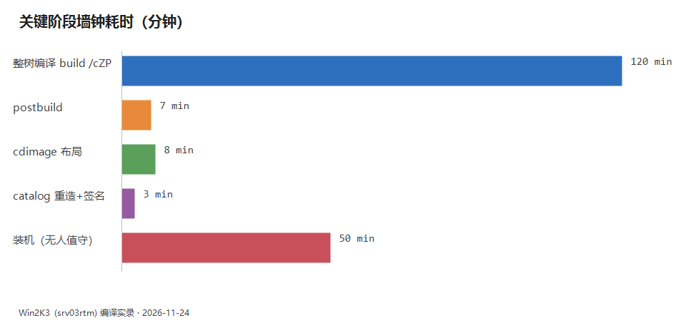
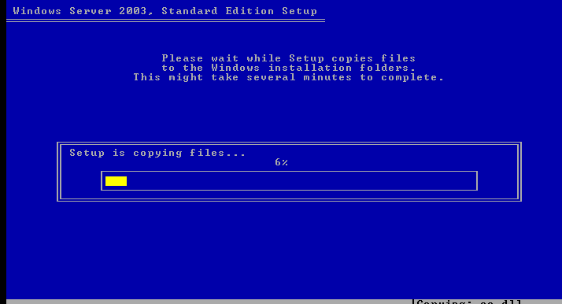
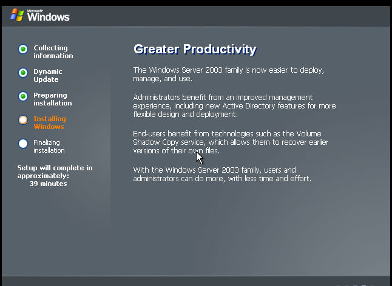
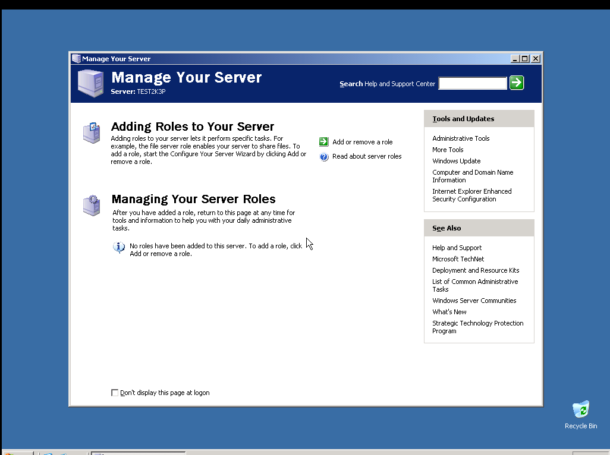
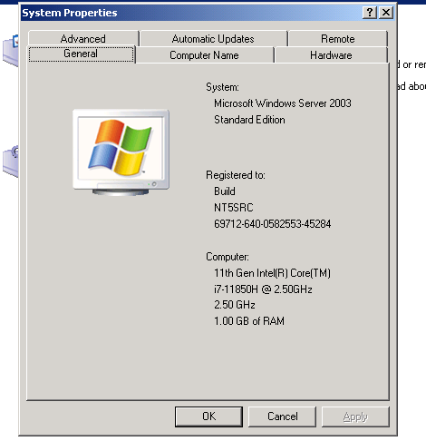
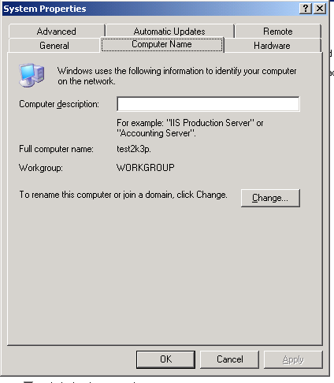
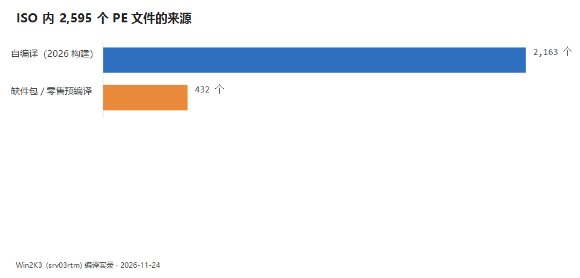

> 2020-09 泄露的 Windows Server 2003（NT 5.2.3790，`srv03rtm`）源码，用一台 Windows 7 SP1 x86 虚拟机
> 整树重编、打包成可安装 ISO，并装进虚拟机跑到桌面。本文记录**环境、步骤、结果、证据与参考**，
> 详细排错过程见 `编译疑难排查手册.md`，从零上手的操作手册见 `编译实践.md`。

| 项目 | 结果 |
|---|---|
| 整树编译 | `build /cZP -M 4`，**1 h 59 min 47 s**，68,704 个文件编出，3 warning / 1 error |
| 产物 | 4,230 个库、4,154 个可执行、9,356 个文件 binplace |
| 内核版本 | `5.2.3790.0 (srckit.261121-1936)` |
| 装机 | 全自动安装 → 进桌面，无 WPA 报错，`For testing purposes only. Build 3790` |
| 自编译占比 | **83.4%**（2,595 个 PE 里 2,163 个是本次构建产出） |
| 交付件 | `srv03_a_v1.iso`（466.0 MB）、`srv03_b_v1.iso`（465.2 MB），见 §6 |

<!--more-->

---

## 1. 环境

### 1.1 宿主机（只是"跑 VM 的壳"）

| 项 | 值 |
|---|---|
| CPU / 内存 | 16 逻辑核 / 31.2 GB |
| 系统盘 | NVMe 954 GB（`C:` 351 / `D:` 302 / `E:` 105 GB） |
| 第二个盘 | **USB 移动硬盘 466 GB**（`F:`）——构建机放这里 |
| 虚拟化 | VMware Workstation（`vmrun` / `vmware-vdiskmanager`） |

> 磁盘是这次唯一的硬约束：整树 `/cZP` 会写 ~45 GB 的 `obj` + `binplace`，
> 加上 5.7 GB 源码，**60 GB 的卷会被写满**（实测 `LNK1201: error writing to program database`）。
> 最终把构建机整机放到 `F:`（USB 盘），宿主的 `C:`/`D:` 只放 ISO 和测试机。

### 1.2 构建机（Windows 7 SP1 x86 虚拟机）

| 项 | 值 |
|---|---|
| 系统 | Windows 7 SP1 **x86（32 位，必须）**，en-US |
| 规格 | 4 vCPU / 1.5–2 GB 内存 / `C:` 60 GB / `D:` 60 GB |
| 账号 | `builder`（管理员），远程只开 WMI + SMB（`LocalAccountTokenFilterPolicy=1`） |
| 源码位置 | `D:\srv03rtm`（必须叫这个名，且**不能用网络盘**） |
| 产物位置 | `D:\binaries.x86fre`（`_NTPostBld`） |
| 语言/区域 | 英文 + `usa`（razzle 传 `-l:usa`） |

构建机里另外挂了一张**零售 Windows Server 2003 Standard 的 ISO**（`G:`），用来补源码缺口里的二进制。

### 1.3 测试机（装完验证）

| 项 | 值 |
|---|---|
| 磁盘 | 8 GB IDE（`vmware-vdiskmanager -c -s 8GB -a ide -t 0`） |
| 内存 | 1024 MB |
| 光驱 | `ide0:1` 指向 ISO，**`ide0:1.startConnected = "TRUE"`** |
| 关键 vmx 项 | `isolation.tools.autoInstall.disable = "TRUE"` 等四条（否则 VMware 会自动挂 `winPreVista.iso`，把我们的盘挤掉） |
| BIOS 启动序 | `cdrom,hdd,floppy` |

### 1.4 版本与工具

| 工具 | 版本/来源 | 用途 |
|---|---|---|
| `razzle.cmd` | 源码树自带 | 设置环境，代理 `build` |
| `build.exe` | 源码树自带 | `/cZP -M 4`：clean + build + postbuild，最多 4 线程 |
| `signtool.exe` | `tools\x86`，5.2 | 签 catalog（**不支持 `/ac`**，见 §4.4） |
| `makecat.exe` | `tools\x86`，16 KB | 造 `nt5.cat` / `nt5inf.cat` |
| `compress.exe` | `tools\x86` | `-zx21 -s` 生成 `*._` 压缩件 |
| `oscdimg.exe` | `base\ntsetup\opktools\wpebins\x86` | 出可引导 ISO（`-n -m -b etfsboot.com`） |
| OpenSSL | 宿主 3.5.x | 拼"带完整链"的 `chain.pfx` |

---

## 2. 准备

### 2.1 源码与目录约定

```cmd
subst X: D:\            :: 源码树必须在 X:\srv03rtm 这种形态下构建
cd X:\srv03rtm
```

构建系统对**路径长度、盘符、空格**都敏感：`TEMP`/`TMP` 要指到 `C:\Temp`（无空格），
源码树不能放在网络盘或共享目录上。

### 2.2 应用预补丁 + prebuild（一次）

官方指南要求的 `win2003_prepatched_v10cb` 必须先覆盖到源码树——它修正了 `prebuild`、
`exinit.c`/`systime.c`，并自带一份 crypto 源码（见 §4.4 的坑）。

```cmd
robocopy <prepatch>\ X:\srv03rtm\ /E /IS /IT
call tools\prebuild.cmd
```

末行必须是 `Prebuild complete`。

### 2.3 重签测试证书（2021-10 之后必须）

泄露源码里带的测试证书链已经过期，必须用社区套件重签（仓库里是 `certutil/`）：

```bash
./generate.sh                 # 生成 root/PCA/VBL03CA/leaf，导出 driver.pfx（口令为空）
```

再把 pfx 导入**机器**证书库（postbuild 在 session 0 跑，用户库看不到容器）：

```cmd
certutil -p "" -importpfx driver.pfx
certutil -store My            # 记下 Key Container 的 GUID，postbuild 要用
```

### 2.4 缺件包（源码里没有的二进制）

源码本身不完整（`winlogon`、`msi`/`gpmc`/`hnw` 的一部分、`printer` 驱动等没有源码），
社区从原版介质里抽了一份"缺失二进制补充包"：

| 项 | 值 |
|---|---|
| 文件 | `win2003_x86-missing-binaries_v2.7z` |
| 大小 | 779,499,743 B |
| SHA-256 | `d141ece0eb7710b655903ee301dec197b1a114618a567100677f0c4d93998c81` |
| 来源 | archive.org item `ti_nt5src`（见 §8） |

解压后覆盖到 `D:\binaries.x86fre`（**覆盖文件夹选"是"，覆盖 `DUser.pdb/dll` 选"否"**）。
我们做过核验：抽 12 个关键件与零售 RTM 盘逐字节比对，**12/12 完全一致**；1,393 个 PE 的时间戳
全部落在 1997–2003，没有 2010 年之后的重编痕迹——即"包是社区拼的，但内容是原版二进制"。

### 2.5 零售介质

再准备一张 **2003 Standard 零售 ISO**。它的用途不是"装系统"，而是当"零件仓库"：
`DRIVER.CAB`、`ASMS01.CAB`、`HIVESXS.INF`、`OEMBIOS.BI_/DA_/SI_`、`PIDGEN.DLL`、`SETUPP.INI`、
license 栈四件、10 个文本安装缺件——一共 26 个文件（清单与校验见
`patches/supplements/`）。

---

## 3. 编译

### 3.1 命令

```cmd
call tools\razzle.cmd free offline no_certcheck exec build /cZP -M 4
```

- `free` = 免费构建（retail 类型）、`offline` = 不取源、`no_certcheck` = 不校验签名工具；
- `/cZP`：`c` 干净、`Z` 编译、**`P` = postbuild**；
- `-M 4`：最多 4 个并发（超过 4 会让构建机抖动甚至 OOM）；
- **必须在干净的 cmd 窗口里跑**：同一窗口第二次 `call razzle.cmd` 会直接打印用法并以 0 退出（假成功）。

### 3.2 结果

| 指标 | 值 |
|---|---|
| 墙钟 | **1:59:47** |
| 编译文件 | 68,704 |
| 警告 / 错误 | 3 / 1 |
| 库 / 可执行 | 4,230 / 4,154 |
| binplace | 9,356 个文件 |

"1 error"是组件级的目录缺失，不是编译失败：

```text
BUILD: winlogon found in ds\security\gina\dirs, is not a subdirectory of d:\srv03rtm\ds\security\gina
net\layer2svc\eapol\parser   -> Net\diagnostics\netmon\sources.inc 不存在
multimedia\reality\misc      -> MultiMedia\reality\rl\ntrlty.mk 不存在
printscan\faxsrv\...\win9x\16 -> 16 位编译器 cl16 不可用
```

> 判据不是"错误数=0"，而是 `BUILD: ... 0 error(s)` + 后续 postbuild 能否跑通。

### 3.3 耗时构成



### 3.4 产物

`D:\binaries.x86fre`（10.4 GB / 108,843 文件）里核心件全部是本次构建产出：

```text
ntoskrnl.exe   ~2.0 MB      5.2.3790.0 (srckit.261121-1936)
ntdll.dll        705,536 B   srckit.261121-1936
kernel32.dll     955,392 B   srckit.261121-1936
advapi32.dll     580,608 B   srckit.261121-1936
smss/csrss/lsass/services/win32k.sys …  全部同日构建
```

唯一的例外是 `winlogon.exe`（源码未泄露，用缺件包的 549,376 B 原版；B 变体换成自编译件，见 §5）。

---

## 4. 打包：从产物到可安装 ISO

### 4.1 postbuild（`/cZP` 的 P 阶段）

第一次跑 postbuild 会报 19 个错，**全部是 `signtool` 失败**：`razzle.cmd:487` 写死了
`/p "12345" /f %RazzleToolPath%\driver.pfx`，而 2003 的 signtool 5.2 读这个 pfx 一律
`IStore2::Load returned error: 0x80090010 Access denied`。

修法：改成用证书库里的密钥容器签名（仓库里已存改好的 `patches/razzle-sign/razzle.cmd`）：

```cmd
SET SIGNTOOL_SIGN=/sm /csp "Microsoft Base Cryptographic Provider v1.0" /k "{<KeyContainer GUID>}" /d "Microsoft Windows TEST" /du "http://ntbld"
```

再跑 `build /P`（只做 postbuild）→ `Postbuild completed successfully`，`postbuild.err` 自动删除。

### 4.2 cdimage：生成安装布局

```cmd
call tools\razzle.cmd free offline no_certcheck exec perl -x tools\postbuildscripts\cdimage_srv.cmd -l:usa
```

产出 `%_NTPostBld%\srv\`（紧凑布局，`i386` 约 5,500 文件）。这里有个泄露缺口：
`cddata.cmd` 生成的 8 个 SKU 清单（`srv*.lst`）是**空的**，必须按 `MakeProdLists`/`MakeCompName`
的规则自己造（字段序、压缩名 `.exe→.ex_` 等细节见手册 §19.3）。

### 4.3 补零售件

```cmd
patches\supplements\provision.cmd  <零售ISO>  %_NTPostBld%\srv\i386
```

脚本从零售 ISO 抽 40 个文件、逐个校验大小+SHA-256（实测 `OK=40 MISMATCH=0 MISSING=0`），
复制 26 个进布局，**故意跳过 14 个零售 `*.CA_`**——它们会把我们自签的 catalog 顶掉，
后果是 SFC 报几千条 + WPA `0x80004005`。

### 4.4 重造目录（CAT）并签名

`nt5.cat` / `nt5inf.cat` 决定"文件是否被微软签名"。重编后二进制全变，必须用**最终布局**重造：

1. 把 `i386` 里所有压缩件 `expand -r` 展开成真实文件名（5,500 个，0 失败）；
2. 写 CDF（成员与 `ResultDir` 都必须是**绝对路径**）；
3. `makecat` → `signtool`。

签名这一步有坑：2003 的 signtool 5.2 **不支持 `/ac`**；Win11 的 signtool 只允许**一个** `/ac`；
用 `/sm /csp /k` 能签成功但 **PKCS#7 里 0 张证书**，目标机建不出链（`0x800B0109`）。
最终方案是用 OpenSSL 拼一个"带完整链"的 pfx（leaf + VBL03CA + Test PCA + Test Root），
再用宿主的 signtool 签——这样 catalog 里内嵌 3 张证书，和微软原版一致。

### 4.5 出 ISO

```cmd
oscdimg.exe -n -m -b<etfsboot.com>  <srv 目录>  srv03_a_v1.iso
```

`-m` 必须加（否则按 74 分钟 CD 的 681,984,000 B 上限报"镜像太大"）。
自检：读第 17 扇区应含 `EL TORITO SPECIFICATION`。

---

## 5. 装机验证

### 5.1 过程

| 阶段 | 现象 | 时间 |
|---|---|---|
| 引导 | `Press any key to boot from CD` → 送一次空格 | 0 min |
| 文本模式 | `Setup is copying files… 0→100%` | 2–8 min |
| 重启 | 自动进入图形阶段 | 8 min |
| GUI | `Installing Windows` / `Installing Devices` | 8–45 min |
| 完成 | `Finalizing installation` → 重启 → 桌面 | ~50 min |







桌面右下角那行 `For testing purposes only. Build 3790` 是 `srckit` 构建（源码套件）特有的水印，
也是"这是自己编的、不是零售盘"最直观的证据（本屏被首次启动的 Manage Your Server 窗口遮住右侧）。

本次复验（2026-11-24，用 `srv03_a_v1.iso` 重新装一遍）从 `disk.vmdk` 里抽出的实际值：

```text
WINDOWS\ok57.txt                      存在，内容 "ok57"
WINDOWS\setuperr.log                  1,226 行，其中 not signed properly = 170
WINDOWS\system32\winlogon.exe         549,376 B   5.2.3790.0 (srv03_rtm.030324-2048)
WINDOWS\system32\ntoskrnl.exe       2,074,624 B   5.2.3790.0 (srckit.261121-1936)
```

### 5.2 判据（不靠屏幕，靠磁盘）

安装是无人值守的（`winnt.sif` 里 `[GuiRunOnce]` 写一个标记文件），所以判定成功与否只看磁盘：

```cmd
7z e <vm>\disk.vmdk "WINDOWS\ok57.txt" "WINDOWS\setuperr.log" "WINDOWS\system32\winlogon.exe" -o<pick>
```

| 判据 | A 版 | B 版 |
|---|---|---|
| 标记文件 | `C:\WINDOWS\ok57.txt` = `ok57` | `C:\WINDOWS\ok62.txt` = `ok62` |
| `winlogon.exe` | 549,376 B / `srv03_rtm.030324-2048` | 175,104 B / `srckit.261121-1936` |
| `setuperr.log` 中 `not signed properly` | 170 条 | 171 条 |

> 那 170/171 条是 `.NET 1.1` redist 等**不在安装布局里**的文件（它们在 CAB/MSI 里被展开），
> 属已知可解释项，不影响功能。

进桌面后打开 `系统属性`，可以直接对着屏幕核一遍"这确实是自编译的 Standard Edition"：



`Registered to` 里的 `Build / NT5SRC` 来自 `winnt.sif` 的 `FullName` / `OrgName`，
产品 ID `69712-640-0582553-45284` 的 `69712` 是 Volume 渠道前缀（对应 §2 里的 VLK）。

`计算机名` 标签页可以直接验证"名字是安装时写进去的"：全名 `test2k3p`、工作组 `WORKGROUP`（未加域），
与 `winnt.sif` 的 `ComputerName=TEST2K3P` 对得上。



### 5.3 覆盖率审计

把 ISO 全量展开、每个文件 `expand` 还原、读 PE 头的时间戳与版本串：



- 自编译 2,163 个（83.4%），其中 `srckit.261121-1936` 1,693 个、其余是第三方版本串；
- 预编译 432 个（16.6%）：`I386` 279（驱动 71、MDAC/Jet/ODBC 77、网络工具 21、WMP 12、安全/登录 10、其它 88）、
  `PRINTERS` 150、`VALUEADD` 2、`SUPPORT` 1。

### 5.4 教训：SMB 是宿主的锅

装好的 2003 在 VMware NAT 里能 ping 通、端口 445/139/135 都开着，但
`net use \\192.168.112.142\IPC$` 报 `System error 64 The specified network name is no longer available`。
原因：**Windows 11 宿主默认没有 SMB1 客户端**（`mrxsmb10`），而 2003 只有 SMB1。
不是客机缺陷，验证请用 WMI 或 `-p err` 日志。

---

## 6. 两个交付变体

| | **A：标准交付件** | **B：自编译 winlogon** |
|---|---|---|
| ISO | `srv03_a_v1.iso` 466.0 MB | `srv03_b_v1.iso` 465.2 MB |
| SHA-256 | `7ED85E041D20325BBDCCFC45F26675C4D72E8D06A9208617D32DEFD81AF132F5` | `466ADE22DEC9128D3BD1DE73F740473DAFC2D30F083542A869CDD3D9B5800E8E` |
| `winlogon.exe` | 549,376 B（缺件包/零售原版） | 175,104 B（Win2000 移植代码自编译） |
| catalog 成员 | 5,500 | 5,501 |
| 自编译占比 | 83.35% | 83.39% |
| 推荐 | **主交付**：唯一外来件是微软原版二进制 | 只作为"源码缺口也能补"的证据 |

B 版装机同样进桌面并写出 `ok62.txt`（判定见 §5.2），只是我们没有把 B 的桌面单独截图存档。

B 的存在意义：`ds\security\gina\dirs` 里列了 `winlogon` 但目录不存在（源码没给），
用社区 `Winlogon200X_v3c` 移植版补上后，**登录界面渲染 → GINA → 自动登录 → 用户配置加载**
整条链路都能由自编译件承担。复现步骤见 `patches/variants/README.md`。

---

## 7. 踩坑速查

| # | 坑 | 一句话修法 | 手册 |
|---|---|---|---|
| 1 | `One of either /D, /Z, /z, or /3 is required` | 组件级用 `build /Z`，全量 `/cZP` | §2 |
| 2 | postbuild 全线 signtool 失败 | 改 `razzle.cmd:487` 用 `/sm /csp /k` | §19.2 |
| 3 | cdimage 的 `srv*.lst` 是空的 | 自己按 `MakeProdLists` 规则生成 8 个清单 | §19.3 |
| 4 | catalog 校验 `0x57`/`0xe0000102` | 用最终布局重造 catalog（含 `syssetup.inf`） | §19.4 |
| 5 | WPA `0x80074005` / `0x80070002` | catalog 必须是**新造**的，且覆盖全部布局文件 | §16 |
| 6 | `0x800B0109 证书链不信任` | catalog 里要内嵌 3 张证书（`chain.pfx`），并让 setup 装 `testroot.cer` | §19.4 |
| 7 | 产品密钥被判无效 | `PIDGEN.DLL`+`SETUPP.INI`+密钥必须同渠道（都用零售/Volume） | §14 |
| 8 | 文本模式缺 `duser.dll`/`acluis.hl_`/`networks` | 用零售 ISO 做名字级差分补件（不是查 txtsetup.sif） | §15 |
| 9 | 装完 SFC 上千条"未签名" | `oembios.*` 与 `OEMBIOS.CAT` 必须同渠道；不要用零售 `*.CA_` 覆盖 | §16 |
| 10 | 删 `bootfix.bin` 后无限重装 | 保留它，用 `vmtype.ps1` 送一次空格过提示 | §19.5 |
| 11 | 构建机"自己消失" | 宿主磁盘满 → VMware 直接杀 VM；`msg.vmxaiomgr.retryabort.diskfull` | §17 |
| 12 | 编完 `binB` 目录是空的 | `binaries_dir X:\bin` 会落地成 `X:\bin.x86fre`（razzle 追加架构后缀） | §21.7 |

---

## 8. 复现路径（十条命令）

```text
1. Win7 SP1 x86 构建机；源码 X:\srv03rtm（≤4 线程，不能网络盘）；TEMP=C:\Temp
2. 覆盖 win2003_prepatched_v10cb → call tools\prebuild.cmd        （末行 Prebuild complete）
3. certutil 重签证书 → certutil -p "" -importpfx driver.pfx        （进机器库）
4. 覆盖缺件包 → robocopy ...\binaries.x86fre D:\binaries.x86fre /E /IS /IT
5. 修 razzle.cmd:487 的 SIGNTOOL_SIGN（patches/razzle-sign/razzle.cmd）
6. call tools\razzle.cmd free offline no_certcheck exec build /cZP -M 4      ≈ 2 小时
7. 造 8 个 srv*.lst → perl -x tools\postbuildscripts\cdimage_srv.cmd -l:usa
8. patches\supplements\provision.cmd <零售ISO> ...\srv\i386
9. expand 全布局 → makecat → signtool /f chain.pfx → compress 出 *.CA_
10. oscdimg -n -m -b etfsboot.com <srv> srv03_a_v1.iso → 装机看 ok57.txt
```

脚本与清单都在仓库里：`patches/iso/`（catalog+打包）、`patches/supplements/`（补件）、
`patches/razzle-sign/`（签名修补）、`patches/variants/`（A/B 两变体定义与逐步命令）。

---

## 9. 参考链接

**上游指南**

- rentry：编译 Windows Server 2003 源码的官方步骤 —— <https://rentry.co/build-win2k3>
- rentry：证书重签 —— <https://rentry.co/win2k3-certutil>
- 缺件包/预补丁的发布页 —— <https://archive.org/details/ti_nt5src>
  （`win2k3_v10a/win2003_x86-missing-binaries_v2.7z`，SHA-256 见 §2.4）
- 社区讨论（重签证书、版本差异）—— <https://wink.messengergeek.com/t/windows-xp-server-2003-source-code-revisited/22711>

**本仓库文档**

| 文件 | 内容 |
|---|---|
| `编译实践.md` | 从 VM 环境到出 ISO 的完整操作手册（含 §11 当前成果） |
| `编译疑难排查手册.md` | §1–§21，每个坑的现象/证据链/修法 |
| `patches/variants/README.md` | A/B 两变体的定义、差异与九步复现 |
| `patches/README.md` | 改过的源码、签名方式、catalog 重建、补件清单 |
| `certutil/` | 证书重签套件 |
| `上游补丁清单.md` | 社区补丁索引 |

---

## 10. 免责声明

仅供技术研究与教育用途。Windows 源码与二进制版权归 Microsoft 所有；文中出现的产品密钥
均为公开的测试/评估用 Volume License Key，测试证书链为本地生成、不具任何生产效力。
